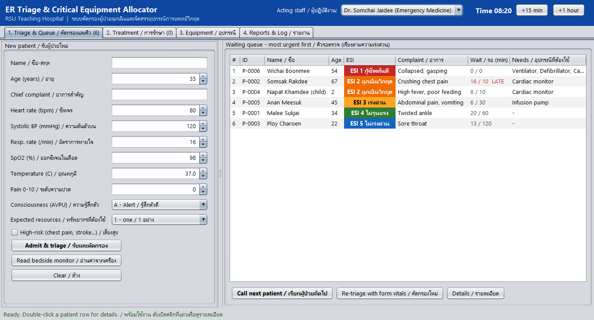
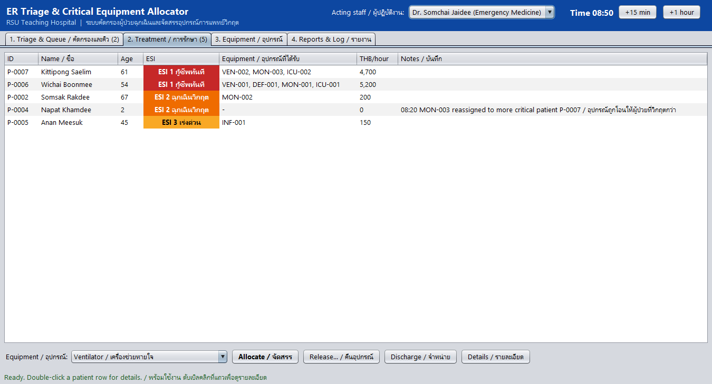
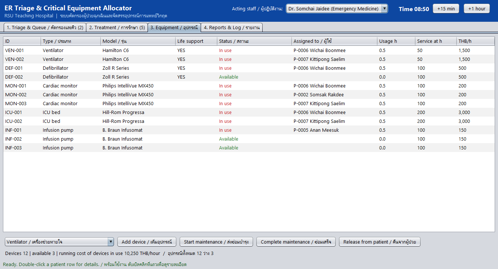
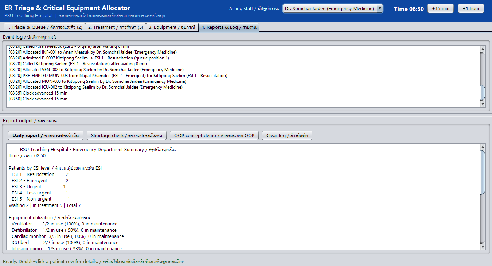

# Hospital Triage & Critical Medical Equipment Allocator

**ระบบคัดกรองผู้ป่วยฉุกเฉินและจัดสรรอุปกรณ์การแพทย์วิกฤต**

A Java Swing desktop application that simulates an emergency room. It triages
patients with the **Emergency Severity Index (ESI v4)**, keeps a live priority
queue, and allocates scarce equipment (ventilators, defibrillators, cardiac
monitors, ICU beds, infusion pumps). A more critical patient can take equipment
away from a less critical one.

โปรแกรมจำลองห้องฉุกเฉิน: คัดกรองผู้ป่วยตามเกณฑ์ ESI v4 จัดคิวตามความเร่งด่วน
และจัดสรรอุปกรณ์ที่มีจำกัด ผู้ป่วยที่วิกฤตกว่าสามารถรับอุปกรณ์ต่อจากผู้ป่วยที่อาการเบากว่าได้

> CSC250 Object-Oriented Programming capstone project, Rangsit University.
> Group **chill until final**.



## Features / ความสามารถ

- **ESI v4 triage**: separate adult and pediatric protocols (age-adjusted vital-sign thresholds, under-3 fever rule).
- **Priority queue**: ordered by urgency score, then arrival time. Children get a small bonus within the same ESI level.
- **Equipment allocation with pre-emption**: uses a free device first; otherwise takes one from a strictly less urgent patient. Life-support devices need a doctor's authorization and an ESI 1–2 patient.
- **Maintenance tracking**: usage hours, service intervals, and maintenance mode.
- **Audit log and daily report**: every allocation, release, and pre-emption is recorded.
- **Legacy device adapter**: reads a vendor bedside monitor (°F, fractional SpO₂) and converts it.
- **Three ways to run**: Swing GUI, text console, and an OOP concept demo, plus 35 automated tests.

## Screenshots

| Treatment | Equipment | Reports & log |
|---|---|---|
|  |  |  |

## Requirements / สิ่งที่ต้องมี

- JDK **17 or newer** (the code is compiled with `--release 17`)
- Any of: Apache NetBeans, IntelliJ IDEA, Eclipse, or just the command line

## Quick start / วิธีรัน

**Windows**

```bat
cd HospitalTriage
run.bat
```

**macOS / Linux**

```bash
cd HospitalTriage
./run.sh
```

Options (add after `run.bat` / `./run.sh`):

| Argument | Mode |
|---|---|
| *(none)* | Swing GUI |
| `--console` | Text menu in the terminal |
| `--demo` | Walk-through of every OOP concept |
| `--test` | Run the 35 automated tests |

**IDE**: open the `HospitalTriage` folder as a project (NetBeans: *File → Open Project*;
IntelliJ: *Open*; Eclipse: *Import → Existing Projects*). The main class is `hospital.Main`.

See the **[User Manual](docs/USER_MANUAL.md)** for a step-by-step guide.

## Project structure / โครงสร้างโปรเจกต์

```
HospitalTriage/
├── src/hospital/
│   ├── Main.java            entry point (GUI / console / demo / test)
│   ├── model/               Person, Patient, PediatricPatient, Staff, Doctor, Nurse, VitalSigns, enums
│   ├── contract/            Prioritizable, Allocatable, Maintainable
│   ├── equipment/           MedicalEquipment + 5 device types, LifeSupport, EquipmentFactory
│   ├── triage/              TriageProtocol (Template Method), Adult/Pediatric protocols, TriageResult
│   ├── generic/             PriorityQueueManager<T>, Inventory<T>, EquipmentReports (wildcards)
│   ├── device/              VitalSignsSource, LegacyVendorMonitor, LegacyMonitorAdapter
│   ├── event/               HospitalEventListener, HospitalEventAdapter
│   ├── exception/           custom checked exceptions
│   ├── service/             HospitalSystem (Facade), AllocationEngine, AllocationRecord
│   ├── ui/                  HospitalGUI (Swing), ConsoleApp
│   ├── demo/                ConceptDemo
│   └── tests/               SystemTest (TC-01 … TC-35)
├── docs/uml/                5 UML class diagrams
├── run.bat, run.sh
└── NetBeans / Eclipse / IntelliJ project files
```

## OOP concepts covered / แนวคิด OOP ที่ใช้

| Concept | Where |
|---|---|
| Encapsulation | private fields with validating setters in `VitalSigns`, defensive copies in `Patient` |
| Pass by value vs. reference | `ConceptDemo` shows primitives vs. object references |
| Inheritance | `Person → Patient → PediatricPatient`, `Person → Staff → Doctor/Nurse`, `MedicalEquipment → 5 devices` |
| `this` / `super` | constructor chaining in `Patient`, `super.getPriorityScore()` in `PediatricPatient`, `Allocatable.super.statusLabel()` |
| Access control | `public` API, `private` state, `protected` fields in `Person`, package-private constructors and `AllocationEngine` |
| Polymorphism | `getPriorityScore()`, `getHourlyCost()`, triage protocol chosen at runtime |
| Abstract class | `Person`, `Staff`, `MedicalEquipment`, `TriageProtocol` (Template Method) |
| Interface | `Prioritizable`, `Allocatable`, `Maintainable` (default-method conflict), `LifeSupport` (marker) |
| Generics | `PriorityQueueManager<T extends Prioritizable>`, `Inventory<T extends MedicalEquipment>` |
| Wildcards | `? extends`, `? super`, `?` in `EquipmentReports` and `PriorityQueueManager` (PECS) |
| Helper classes | inner (`DailyReport`, `InventoryIterator`), local (`Shortage`, `FilteredIterator`), anonymous, lambda, adapter (`WindowAdapter`, `HospitalEventAdapter`, `LegacyMonitorAdapter`) |
| Others | custom exceptions, enums with fields, Factory / Facade / Observer patterns |

UML diagrams are in [`HospitalTriage/docs/uml`](HospitalTriage/docs/uml).

## Author / ผู้พัฒนา

ณพัชรกัณฑ์ พัชญ์ชัยพงศา, designer and programmer.
